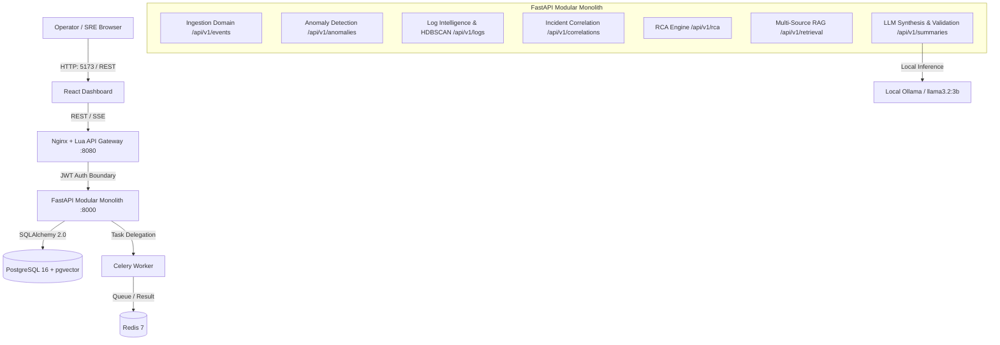

# Vermithor — AI Production Incident Intelligence Platform

Vermithor is an autonomous AI-assisted incident management and root-cause intelligence platform designed for modern SRE and DevOps teams. It automates the end-to-end operational lifecycle: streaming telemetry ingestion, metric anomaly detection, dense vector log embedding with HDBSCAN density clustering, service topology and trace-aware root cause analysis (RCA), vector-indexed runbook retrieval (RAG), structured LLM synthesis with local Ollama (`llama3.2:3b`), and deterministic multi-point evidence validation.

---

## 1. Project Overview

Production incident response is frequently slowed down by fragmented log aggregators, noisy alert storms, incomplete topology graphs, and unverified AI hallucinations. Vermithor solves these challenges by combining statistical anomaly detection, unsupervised log clustering, topology-aware causal graph analysis, vector search, and grounded LLM reasoning into a unified FastAPI modular monolith.

### Key Highlights:
- **Noise Reduction & Clustering**: Groups millions of log streams into representative patterns using MiniLM-L6-v2 vector embeddings and HDBSCAN density clustering.
- **Topology-Aware RCA**: Evaluates service dependencies using NetworkX directed acyclic graphs (DAGs) and trace propagation to pin down root causes.
- **Hallucination-Free Synthesis**: Uses multi-point programmatic evidence validation to ensure LLM incident summaries strictly match ingested telemetry.
- **Ambiguity Preservation**: When incident evidence is insufficient or noisy, Vermithor explicitly retains an `UNKNOWN` state instead of fabricating root cause diagnoses.
- **Local-First & Privacy-Preserving**: Operates entirely on-premises or in private cloud environments using local vector storage (`pgvector`) and local LLMs (Ollama).

---

## 2. Architecture & Pipeline

Vermithor is built as a high-performance **FastAPI Modular Monolith** fronted by an Nginx + Lua API Gateway, backed by PostgreSQL 16 (`pgvector`), Redis 7, and Celery asynchronous task workers.



### End-to-End Data Pipeline

```text
Telemetry / Logs / Metrics / Traces
      ↓
Ingestion (/api/v1/events)
      ↓
Anomaly Detection (z-score + Isolation Forest)
      ↓
Log Intelligence (Normalization, 384-D MiniLM-L6-v2, HDBSCAN)
      ↓
Incident Correlation (Sliding Temporal Window, Topology Boundary)
      ↓
Service Topology (NetworkX Directed Dependency Graph)
      ↓
Root Cause Analysis (Multi-Factor Scoring Engine)
      ↓
Retrieval / Runbooks / Historical Incidents (pgvector Cosine Distance)
      ↓
LLM Synthesis (Strict JSON Schema, Grounded Prompting)
      ↓
Evidence Validation (Telemetry Scope Verification, Hallucination Defense)
      ↓
Incident Explanation / RCA Report
```

---

## 3. Implemented Features

| Feature Domain | Implementation Details |
|---|---|
| **Telemetry Ingestion** | Ingests logs, metrics, traces, and deployment markers via standard HTTP `/api/v1/events` endpoints. |
| **Anomaly Detection** | Dual-engine metric anomaly detection combining statistical Z-score thresholds and unsupervised `IsolationForest`. |
| **Log Intelligence** | Automated regex masking, 384-D dense vector embedding (`all-MiniLM-L6-v2`), and `HDBSCAN` density clustering to collapse log noise. |
| **Incident Correlation** | Dynamic time-window correlation linking related anomalies across microservice topology boundaries. |
| **Service Topology** | NetworkX causal graph mapping microservice dependencies and downstream error propagation paths. |
| **Multi-Dimensional RCA** | Weighted scoring engine combining temporal precedence, anomaly severity, topology distance, and deployment correlation. |
| **Vector RAG Retrieval** | Vector similarity search using PostgreSQL `pgvector` extension to surface relevant runbooks and historical post-mortems. |
| **LLM Synthesis** | Structured prompt assembly generating root cause summaries, blast radius analysis, and mitigation steps via Ollama (`llama3.2:3b`). |
| **Evidence Validation** | Programmatic verification ensuring all claims in LLM output map to real telemetry observations. |
| **`UNKNOWN` Handling** | Preserves `UNKNOWN` root cause classification when correlation scores fall below the confidence threshold ($\le 0.40$). |
| **Observability** | Prometheus metric scraping endpoints, Grafana dashboard definitions, and OpenTelemetry OTLP tracing integration. |
| **Evaluation Framework** | Automated evaluation runner benchmarking precision, recall, cluster purity, RCA accuracy, and LLM claim grounding across 7 scenarios. |

---

## 4. Technology Stack

| Component | Technology | Version / Specification |
|---|---|---|
| **Backend Framework** | Python / FastAPI | Python 3.10+, FastAPI `^0.110.0`, Pydantic `^2.6.0`, Uvicorn |
| **Database** | PostgreSQL | PostgreSQL 16 with `pgvector` extension (`^0.2.5`), SQLAlchemy 2.0 |
| **Cache & Task Queue** | Redis & Celery | Redis 7 Alpine, Celery `^5.3.6` |
| **Frontend** | React / TypeScript | React 18, TypeScript 5, Vite, Tailwind CSS, TanStack Query |
| **API Gateway** | OpenResty / Nginx | Nginx with Lua JWT (HS256) authentication boundary |
| **Embeddings** | SentenceTransformers | `sentence-transformers/all-MiniLM-L6-v2` (384-dimensional vector space) |
| **Machine Learning** | Scikit-Learn / SciPy | Scikit-Learn (HDBSCAN, IsolationForest), NumPy, SciPy |
| **LLM Engine** | Ollama | Ollama running `llama3.2:3b` with rule-grounded fallback mechanism |
| **Observability** | OpenTelemetry / Prometheus | OpenTelemetry SDK, Prometheus Client, Jaeger Tracing, Grafana |
| **Testing & QA** | Pytest | `pytest`, `pytest-asyncio`, `pytest-mock` |
| **Containerization** | Docker | Docker Compose, Kubernetes manifests, Helm v3 charts |

---

## 5. Repository Structure

```text
Vermithor/
├── .env.example              # Master configuration template
├── .gitignore                # Comprehensive Git exclusion rules
├── .dockerignore             # Docker build context exclusions
├── docker-compose.yml        # Multi-container local orchestration stack
├── alembic.ini               # Alembic database migration configuration
├── backend/
│   ├── Dockerfile            # Container definition for backend API & Celery worker
│   ├── requirements.txt      # Python backend dependencies
│   ├── alembic/              # Database migration scripts (001_initial_schema.py)
│   ├── app/
│   │   ├── main.py           # FastAPI entry point & lifespan manager
│   │   ├── common/           # Config, database engine, security, telemetry
│   │   ├── anomaly/          # Metric anomaly detection module
│   │   ├── correlation/      # Incident correlation module
│   │   ├── incidents/        # Incident management module
│   │   ├── ingestion/        # Telemetry ingestion module
│   │   ├── log_intelligence/ # Log embedding & HDBSCAN clustering module
│   │   ├── rca/              # Topology & multi-factor RCA engine
│   │   ├── retrieval/        # RAG retrieval & runbook management module
│   │   ├── summary/          # LLM synthesis & evidence validation module
│   │   └── topology/         # Service graph & dependency topology module
│   ├── shared/               # Shared telemetry & tracing helpers
│   └── tests/                # Domain-specific unit & integration tests
├── frontend/
│   ├── Dockerfile            # Multi-stage Vite/Nginx frontend container
│   ├── package.json          # React/TypeScript dependencies
│   ├── src/                  # React UI components & TanStack query hooks
│   └── vite.config.ts        # Vite build configuration
├── gateway/
│   ├── Dockerfile            # Nginx + Lua gateway container
│   ├── nginx.conf            # Reverse proxy & routing config
│   └── jwt_auth.lua          # Lua JWT HS256 verification module
├── evaluation/
│   ├── evaluator.py          # Benchmark runner & metrics suite
│   ├── report.md             # Benchmark evaluation output report
│   ├── results/              # Machine-readable evaluation JSON artifacts
│   └── scenarios/            # 7 YAML operational incident scenarios
├── infrastructure/
│   ├── docker/               # Container configurations
│   ├── grafana/              # Pre-provisioned dashboards & data sources
│   ├── helm/                 # Helm chart specifications
│   ├── kubernetes/           # Kubernetes manifests & Kind cluster config
│   └── prometheus/           # Prometheus scraping target configurations
├── docs/                     # Comprehensive technical documentation suite
└── scripts/                  # Synthetic incident generation & demo runners
```

---

## 6. Installation & Setup

### Prerequisites
- **Docker & Docker Compose** (v24.0+)
- **Python** (v3.10+)
- **Node.js** (v18+) & **npm** (for frontend development)
- (Optional) **Ollama** installed with `llama3.2:3b` model pulled (`ollama pull llama3.2:3b`)

### Step-by-Step Local Development Setup

#### 1. Clone Repository & Setup Environment
```bash
git clone https://github.com/vermithor/vermithor.git
cd Vermithor

# Create local environment configuration
cp .env.example .env
```

#### 2. Start Supporting Infrastructure
Start PostgreSQL (with `pgvector`), Redis, Prometheus, Grafana, and Jaeger:
```bash
docker compose up -d postgres redis prometheus grafana jaeger
```

#### 3. Setup Python Virtual Environment & Install Dependencies
```bash
python -m venv .venv

# Linux / macOS
source .venv/bin/activate

# Windows PowerShell
.\.venv\Scripts\Activate.ps1

# Install backend dependencies
pip install -r backend/requirements.txt
```

#### 4. Execute Database Migrations
Apply PostgreSQL database schema and enable `pgvector` extensions:
```bash
alembic upgrade head
```

#### 5. Start Backend API & Celery Worker
```bash
# Terminal 1: Uvicorn API Server
uvicorn backend.app.main:app --host 0.0.0.0 --port 8000 --reload

# Terminal 2: Celery Asynchronous Worker
celery -A backend.workers.celery_app worker --loglevel=info --concurrency=2
```

#### 6. Setup and Start Frontend Dashboard
```bash
# Terminal 3: React Frontend
cd frontend
npm install
npm run dev
```
Access the application at `http://localhost:5173`.

---

## 7. Configuration Reference

All application settings are managed via environment variables defined in `backend/app/common/config.py`.

| Environment Variable | Required | Default | Description |
|---|---|---|---|
| `APP_ENV` | No | `development` | Deployment environment (`development`, `production`, `test`). |
| `LOG_LEVEL` | No | `INFO` | Logging level (`DEBUG`, `INFO`, `WARNING`, `ERROR`). |
| `SERVICE_NAME` | No | `vermithor-backend` | Telemetry service identifier. |
| `PORT` | No | `8000` | Backend API server port. |
| `HOST` | No | `0.0.0.0` | Backend API bind address. |
| `POSTGRES_USER` | Yes | `vermithor` | PostgreSQL database user. |
| `POSTGRES_PASSWORD` | Yes | `vermithor_password` | PostgreSQL database password. |
| `POSTGRES_DB` | Yes | `vermithor` | PostgreSQL database name. |
| `POSTGRES_HOST` | No | `localhost` | PostgreSQL database host address. |
| `POSTGRES_PORT` | No | `5432` | PostgreSQL database port. |
| `DATABASE_URL` | No | *Computed* | SQLAlchemy database connection string (`postgresql+psycopg://...`). |
| `REDIS_URL` | No | `redis://localhost:6379/0` | Redis cache connection string. |
| `CELERY_BROKER_URL` | No | `redis://localhost:6379/0` | Celery broker URL. |
| `CELERY_RESULT_BACKEND` | No | `redis://localhost:6379/0` | Celery result backend URL. |
| `JWT_SECRET` | Yes | `vermithor-dev-secret-key-32-chars-min` | HS256 secret key for API Gateway authentication. |
| `JWT_ISSUER` | No | `vermithor` | Expected JWT issuer token claim. |
| `JWT_AUDIENCE` | No | `vermithor-api` | Expected JWT audience token claim. |
| `STATISTICAL_WARNING_Z` | No | `3.0` | Z-score threshold for warning metric anomalies. |
| `STATISTICAL_CRITICAL_Z` | No | `4.0` | Z-score threshold for critical metric anomalies. |
| `ISOLATION_FOREST_CONTAMINATION` | No | `auto` | Contamination factor for IsolationForest detector. |
| `EMBEDDING_MODEL_NAME` | No | `sentence-transformers/all-MiniLM-L6-v2` | Sentence Transformers model for dense log vectors. |
| `EMBEDDING_DIMENSION` | No | `384` | Vector dimension size of embeddings. |
| `EMBEDDING_DEVICE` | No | `cpu` | PyTorch execution target (`cpu`, `cuda`). |
| `LLM_PROVIDER` | No | `ollama` | LLM provider backend (`ollama`). |
| `LLM_MODEL` | No | `llama3.2:3b` | Local Ollama model tag. |
| `OLLAMA_BASE_URL` | No | `http://localhost:11434` | Ollama HTTP REST API base URL. |
| `LLM_TIMEOUT_SECONDS` | No | `120` | Maximum timeout for LLM synthesis requests. |
| `LLM_FALLBACK_ENABLED` | No | `false` | Enable rule-grounded fallback when LLM is unavailable. |
| `OTEL_EXPORTER_OTLP_ENDPOINT` | No | `http://localhost:4318` | OpenTelemetry OTLP HTTP exporter collector URL. |

---

## 8. API Endpoint Reference

The backend exposes interactive Swagger documentation at `http://localhost:8000/docs` and ReDoc at `http://localhost:8000/redoc`.

### Health & System Status
- `GET /health` — Liveness probe returning service health status.
- `GET /ready` — Readiness probe checking database connectivity and subsystem initialization.
- `GET /` — Root metadata endpoint.

### Core Domain APIs (`/api/v1`)
- **Telemetry Ingestion**: `POST /api/v1/events` — Submit raw log streams, metric data points, trace spans, or deployment events.
- **Incidents**: `GET /api/v1/incidents`, `POST /api/v1/incidents`, `GET /api/v1/incidents/{id}` — Manage correlated operational incidents.
- **Observations & Anomalies**: `GET /api/v1/observations`, `GET /api/v1/anomalies` — Query metric observations and detected anomalies.
- **Correlations**: `GET /api/v1/correlations`, `POST /api/v1/correlations/evaluate` — Trigger sliding-window incident correlation.
- **Root Cause Analysis**: `POST /api/v1/rca/analyze` — Run multi-factor topology RCA on an incident.
- **Log Intelligence**: `POST /api/v1/logs/cluster` — Trigger vector embedding and HDBSCAN log clustering.
- **Retrieval (RAG)**: `POST /api/v1/retrieval/search` — Perform cosine similarity vector search over runbooks and post-mortems.
- **Runbooks**: `GET /api/v1/runbooks`, `POST /api/v1/runbooks` — Manage operational runbook repository.
- **Summaries**: `POST /api/v1/summaries/generate` — Generate structured, validated LLM incident summaries.

---

## 9. Running the Application

### Full Docker Compose Stack
To run the complete system (gateway, backend, worker, frontend, databases, observability) in Docker:
```bash
docker compose up --build -d
```

### Demonstration Runner
Execute pre-built synthetic incident scenarios through the end-to-end intelligence pipeline:

**Linux / macOS**:
```bash
./scripts/run-demo.sh database
```

**Windows PowerShell**:
```powershell
.\scripts\run-demo.ps1 database
```

Available demo scenarios: `database`, `deployment`, `redis`, `memory`, `traffic`, `auth`, `ambiguous`, `all`.

---

## 10. Testing & Quality Assurance

Execute the unit, integration, and resilience test suites:

```bash
# Run all backend unit and domain tests
python -m pytest backend/tests/ -v

# Run gateway unit tests
python -m pytest gateway/tests/ -v

# Run resilience tests
python -m pytest tests/resilience/ -v
```

---

## 11. Evaluation Framework

Vermithor includes an automated benchmark suite (`evaluation/evaluator.py`) that evaluates platform performance against 7 synthetic operational scenarios (`database_saturation`, `bad_deployment`, `redis_failure`, `memory_exhaustion`, `traffic_spike`, `auth_failure`, `ambiguous_noise`).

### Run Benchmark Suite:
```bash
python evaluation/evaluator.py
```

### Benchmark Metrics & Repository Results:
| Metric | Result | SLA Target | Status |
|---|---|---|---|
| **RCA Top-1 Accuracy** | **100.0%** (7/7) | $\ge 80.0\%$ | ✅ PASSED |
| **RCA Top-3 Accuracy** | **100.0%** (7/7) | $\ge 95.0\%$ | ✅ PASSED |
| **RCA Mean Reciprocal Rank (MRR)** | **1.000** | $\ge 0.850$ | ✅ PASSED |
| **Anomaly Detection F1 Score** | **1.000** | $\ge 0.950$ | ✅ PASSED |
| **LLM JSON Schema Validity** | **100.0%** | $100.0\%$ | ✅ PASSED |
| **`UNKNOWN` Ambiguity Preservation** | **100.0%** | $100.0\%$ | ✅ PASSED |

Generated evaluation output reports are saved to `evaluation/results/latest.json` and `evaluation/report.md`.

---

## 12. Observability

When running the Docker Compose stack, the following observability services are accessible:

| Service | Local URL | Description / Default Credentials |
|---|---|---|
| **API Gateway** | `http://localhost:8080` | Reverse proxy entry point with JWT validation. |
| **Backend API Specs** | `http://localhost:8000/docs` | OpenAPI / Swagger interactive documentation interface. |
| **React Dashboard** | `http://localhost:5173` | Operator UI for incident timelines, graph visualization, and AI summaries. |
| **Prometheus UI** | `http://localhost:9090` | Golden signal metrics scraping & query console. |
| **Grafana Dashboards** | `http://localhost:3000` | Pre-configured dashboard (`admin` / `admin_password`). |
| **Jaeger UI** | `http://localhost:16686` | Distributed trace waterfall visualization console. |

---

## 13. Security Model

- **Gateway Security Boundary**: OpenResty/Nginx enforces HS256 HMAC-SHA256 JWT validation prior to proxying requests to the backend monolith.
- **Secret Management**: Passwords, secrets, and private keys must be specified via environment variables (`.env`) and never committed to Git.
- **CORS Policies**: Cross-Origin Resource Sharing is configurable via FastAPI middleware in `backend/app/main.py`.
- **Local Air-Gapped Execution**: Embeddings and LLM synthesis operate completely locally without leaking telemetry to external third-party cloud APIs.

---

## 14. Known Limitations

- **Ollama Hardware Requirements**: Running local LLM inference (`llama3.2:3b`) requires a minimum of 8 GB RAM (or GPU acceleration for low latency).
- **Synthetic Benchmark Scenarios**: Evaluation dataset results are derived from simulated operational scenarios in `evaluation/scenarios/`.
- **Single-Node Queue Default**: Default Celery and Redis configurations target single-node execution and require clustering for extreme enterprise scale.
- **JWT Key Pre-Sharing**: Gateway JWT validation relies on shared symmetric secret keys (`JWT_SECRET`).

---

## 15. Technical Documentation Index (`docs/`)

For in-depth technical details, consult the documentation suite in `docs/`:

- [Architecture Overview](docs/architecture.md) — System design, data flow, and domain module breakdown.
- [Setup Guide](docs/setup.md) — Local installation, database setup, and dependency management.
- [Configuration Reference](docs/configuration.md) — Full environment variable specification.
- [API Reference](docs/api.md) — Complete endpoint schemas, request/response models, and error behaviors.
- [Development Guide](docs/development.md) — Code structure, linting, migrations, and contributing guidelines.
- [Testing Guide](docs/testing.md) — Running unit, integration, and resilience test suites.
- [Evaluation Framework](docs/evaluation.md) — Benchmark scenarios, metrics calculation, and evaluation methodology.
- [Deployment Guide](docs/deployment.md) — Docker Compose, Nginx Gateway, and Kubernetes/Helm setup.
- [Observability Guide](docs/observability.md) — Prometheus metrics, Grafana dashboards, and Jaeger tracing.
- [Security Guide](docs/security.md) — Authentication, secret management, and network exposure policies.
- [Troubleshooting Guide](docs/troubleshooting.md) — Diagnostics for common database, Redis, Celery, and Ollama runtime issues.

---

## 16. License & Security Policies

- Refer to [SECURITY.md](SECURITY.md) for security reporting guidelines and vulnerability management procedures.
