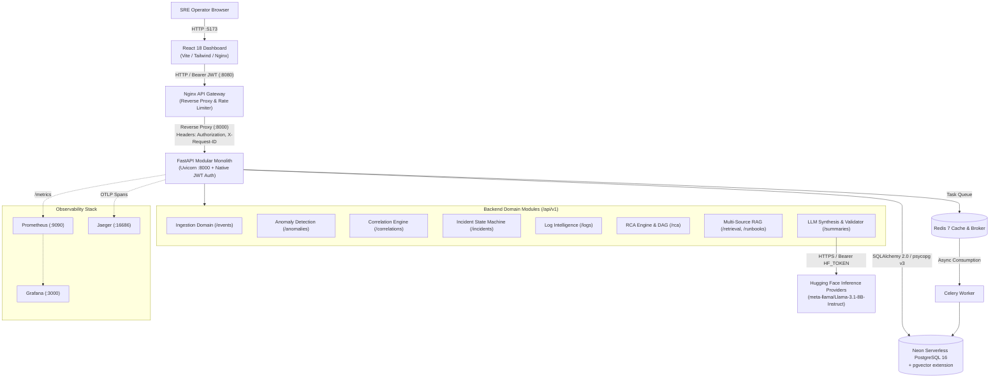

# Vermithor — AI Production Incident Intelligence Platform

Vermithor is an AI-assisted incident management and root-cause intelligence platform designed for modern Site Reliability Engineering (SRE) and DevOps teams. It automates the full operational incident lifecycle: streaming telemetry ingestion, metric anomaly detection, dense vector log embedding with unsupervised clustering, service topology and trace-aware Root Cause Analysis (RCA), vector-indexed runbook retrieval (RAG), structured LLM synthesis via Hugging Face Inference Providers, and programmatic evidence validation.

---

## 1. Key Capabilities

- **Streaming Telemetry Ingestion**: High-throughput intake of logs, metric points, distributed trace spans, and deployment markers via standard REST endpoints.
- **Dual-Engine Metric Anomaly Detection**: Combines rolling statistical Z-score thresholds with unsupervised scikit-learn `IsolationForest` models.
- **Log Intelligence & Noise Reduction**: Regex secret sanitization, Drain template extraction, 384-dimensional dense vector embeddings (`all-MiniLM-L6-v2`), and HDBSCAN density clustering.
- **Service Topology & Causal RCA**: Builds directed acyclic causal graphs (DAGs) using NetworkX, inferring failure directionality from temporal precedence and architecture hierarchy.
- **Ambiguity Preservation**: When incident telemetry is noisy or inconclusive, Vermithor explicitly retains an `UNKNOWN` root cause rather than fabricating diagnoses.
- **Multi-Source RAG Context Assembly**: Hybrid cosine similarity search over operational runbooks and historical postmortems with token budgeting.
- **Evidence-Grounded LLM Postmortems**: Calls Hugging Face Inference Providers (`meta-llama/Llama-3.1-8B-Instruct`) with low temperature ($0.1$) and structured JSON schema enforcement.
- **Hallucination Defense**: Programmatic `EvidenceValidator` audits every LLM claim against verified telemetry IDs, stripping ungrounded citations.
- **Deterministic Resilience Fallback**: Automatically degrades to rule-grounded synthesis directly from verified RCA data if the LLM provider is unavailable or rate-limited.

---

## 2. Latest Demonstration Status (Synthetic Incident INC-2026-1042)

> [!IMPORTANT]
> **Demonstration Verdict: Demo Passed with Limitations**
> The end-to-end incident intelligence and investigation pipeline was successfully demonstrated on canonical synthetic incident `INC-2026-1042` (`payment-api` v2.8.4 deployment followed by database connection pool saturation).
> 
> **Operational Limitations**:
> 1. **Ollama LLM Provider Offline**: Local Ollama inference (`http://localhost:11434`) was offline during the demonstration. Vermithor automatically engaged its built-in deterministic grounded fallback synthesizer (`is_fallback: true`, `model_provider: "fallback"`), successfully generating complete postmortems and investigation reports with 100% telemetry grounding and zero hallucinations.
> 2. **Telemetry Scope & Deployment Boundaries**: The demonstration verified synthetic incident injection and supervised read-only pilot execution. **Live customer telemetry** and **automated production deployment** were not verified; repair proposals operate under strict human-approval and read-only pilot guardrails (`is_read_only_pilot: true`).

### Demonstrated End-to-End Workflow Capabilities

| Stage | Demonstrated Behavior & Artifacts | Status |
|---|---|:---:|
| **Telemetry Ingestion & Anomaly Detection** | Ingested streaming events, logs, and metric observations. Statistical Z-score and `IsolationForest` detectors flagged 10 metric anomalies: pool utilization (1.00), P95 latency (4800ms), DB query latency (3200ms), and HTTP 5xx error rate ratio (0.28). | ✅ Passed |
| **Correlation & Incident Registration** | Correlated 14 temporal/topological signals across `payment-api` and `postgres` into correlation group `GRP-000004` (score: 0.53); registered SEV1 incident `INC-2026-1042`. | ✅ Passed |
| **Ranked Root-Cause Hypotheses** | Multi-dimensional RCA evaluated and ranked 3 causal candidates: <br/>1. **Database degradation on postgres** (Composite Score: `0.909`)<br/>2. **Database connection pool exhaustion on payment-api** (Composite Score: `0.845`)<br/>3. **Service degradation on payment-api** (Composite Score: `0.804`) | ✅ Passed |
| **LangGraph AI Investigation** | Executed LangGraph agent workflow (`INV-000141`), evaluating 26 observed facts. Confirmed leading hypothesis `[DEPLOYMENT] Recent deployment on payment-api` with **0.98 confidence** based on temporal precedence and HikariCP connection leaks. | ✅ Passed |
| **Evidence Citations** | Programmatically cataloged 38 telemetry citations (e.g. `EV-EVT-25`, `EV-RCA-1`). The citation validator verified 100% (`38/38`) as `VALID` and grounded in ingested telemetry IDs. | ✅ Passed |
| **Investigation Persistence & Retrieval** | Persisted complete investigation state to PostgreSQL. Verified via REST endpoints `GET /api/v1/agent/investigations/incident/INC-2026-1042` and `GET /api/v1/agent/investigations/INV-000141`. | ✅ Passed |
| **Human-Approved Repair Proposals** | Generated patch proposal `REP-000107` proposing `max_pool_size` tuning in `src/config.py`. Enforced safety boundary (`requires_human_approval: true`, `is_read_only_pilot: true`). Supervised approval recorded via `POST /api/v1/agent/repairs/REP-000107/approve` without autonomous git push or deployment (`pull_request_url: null`). | ✅ Passed |
| **Frontend UI Verification** | Verified live rendering of `IncidentHeader`, `IncidentOverview`, `InvestigationPanel`, `CodeRepairPanel`, `RCAExplanation`, `CorrelationGraph`, and `RunbookPanel` at `http://localhost:5173/incidents/INC-2026-1042`. | ✅ Passed |

### Database Migration Reproducibility & Alembic Version Fix

Alembic's default `alembic_version` schema defines `version_num VARCHAR(32)`. When migration revisions exceed 32 characters (e.g., `007_add_pilot_onboarding_and_governance` at 39 characters and `008_add_org_id_to_investigations_and_repairs` at 44 characters), PostgreSQL throws a `StringDataRightTruncation` error during `alembic upgrade head`.

- **Automated Reproducibility**: Migration `005_add_repository_connections.py` automatically expands `alembic_version.version_num` to `VARCHAR(128)` on PostgreSQL dialects before revisions 007 and 008 execute.
- **Manual Migration Fix**: If upgrading an existing PostgreSQL instance where revision 005 was already tracked without the expansion, run the following SQL command prior to `alembic upgrade head`:
  ```sql
  ALTER TABLE alembic_version ALTER COLUMN version_num TYPE VARCHAR(128);
  ```

---

## 3. Technology Stack

| Layer | Technologies |
|---|---|
| **API Gateway** | Nginx (`nginx:alpine`), reverse proxy, tiered rate limiting, security headers |
| **Frontend** | React 18, TypeScript, Vite, Tailwind CSS, TanStack Query |
| **Backend API** | FastAPI, Uvicorn, Python 3.10/3.12, Pydantic v2, native HS256 JWT auth |
| **Database & Search** | Neon Serverless PostgreSQL 16, `pgvector`, SQLAlchemy 2.0, `psycopg` v3, Alembic |
| **AI / Machine Learning** | Hugging Face Cloud Inference Providers (Feature Extraction & LLM), `sentence-transformers/all-MiniLM-L6-v2` (384-D), `scikit-learn`, `HDBSCAN`, NetworkX |
| **LLM Provider** | Hugging Face Inference Providers (`meta-llama/Llama-3.1-8B-Instruct`) via OpenAI-compatible router |
| **Vector Embeddings** | Hugging Face Inference Providers (`sentence-transformers/all-MiniLM-L6-v2`, 384-D) + Neon `pgvector` |
| **Observability** | Prometheus (metrics), Grafana (dashboards), Jaeger (OTLP distributed tracing) |
| **Orchestration** | Docker Compose (local development), Kubernetes & Helm (production) |

---

## 4. High-Level Architecture



---

## 5. Documentation Index

The primary documentation is organized into five focused guides inside `docs/`:

1. [**System Architecture (`docs/architecture.md`)**](docs/architecture.md)
   Complete system architecture, component responsibilities, request flow, AI/ML pipelines, Neon integration, observability, and evaluation benchmarks.
2. [**API Reference (`docs/api.md`)**](docs/api.md)
   Full REST API specification for all `/api/v1/*` endpoints, health probes, JWT auth contract, rate limit tiers, and Curl/PowerShell examples.
3. [**Developer Guide (`docs/development.md`)**](docs/development.md)
   Local setup instructions for Windows PowerShell and Linux, virtual environments, Neon configuration, Alembic migrations, testing suites, and troubleshooting.
4. [**Deployment Guide (`docs/deployment.md`)**](docs/deployment.md)
   Docker Compose 9-service orchestration, startup ordering, Kubernetes Helm charts, secret management, health probes, backups, and production readiness gaps.
5. [**Security Architecture (`docs/security.md`)**](docs/security.md)
   Perimeter JWT verification, rate limiting, DoS defenses, secret isolation, Neon TLS transport, AI prompt injection guardrails, and compliance matrix.

---

## 6. Prerequisites

Before setting up Vermithor, ensure you have:
- **Python**: Version `3.10` or higher (verified on 3.10 and 3.12).
- **Node.js**: Version `18.0` or higher with `npm`.
- **Git**: Latest release.
- **Docker Desktop / Compose**: Docker 24.0+ with Compose v2 (or WSL2).
- **Neon PostgreSQL Project**: Free-tier or production serverless PostgreSQL with `pgvector` enabled (no local PostgreSQL container required).
- **Hugging Face Account (Optional)**: Free-tier user access token for live LLM synthesis (`HF_TOKEN`).

---

## 7. Quick-Start Guide (Local Development)

### Step 1: Clone Repository & Create `.env`
```bash
git clone https://github.com/vermithor/vermithor.git
cd Vermithor

# Copy configuration template
cp .env.example .env
```

### Step 2: Configure Neon PostgreSQL
Add your Neon connection strings to `.env`:
```env
# Pooled connection string (used by backend and workers)
DATABASE_URL=postgresql+psycopg://neondb_owner:<YOUR_PASSWORD>@ep-...-pooler.neon.tech/neondb?sslmode=require

# Direct unpooled connection string (used by Alembic DDL migrations)
DATABASE_URL_UNPOOLED=postgresql+psycopg://neondb_owner:<YOUR_PASSWORD>@ep-....neon.tech/neondb?sslmode=require
```

### Step 3: Set Up Python Environment (PowerShell)
```powershell
python -m venv .venv
.\.venv\Scripts\Activate.ps1
python -m pip install --upgrade pip
pip install -r backend/requirements.txt
```

### Step 4: Run Alembic Database Migrations
```powershell
alembic upgrade head
```
> [!NOTE]
> **PostgreSQL Alembic Version Column**: Migration `005_add_repository_connections.py` automatically expands `alembic_version.version_num` from `VARCHAR(32)` to `VARCHAR(128)` to accommodate longer revision names. If updating an existing PostgreSQL database where revision 005 was already applied prior to the fix, execute `ALTER TABLE alembic_version ALTER COLUMN version_num TYPE VARCHAR(128);` before running migrations.

### Step 5: Start Supporting Services (Docker)
```powershell
docker compose up -d redis jaeger prometheus grafana
```

### Step 6: Start Applications
In separate terminal sessions:

```powershell
# 1. Start FastAPI Backend
uvicorn backend.app.main:app --host 0.0.0.0 --port 8000 --reload

# 2. Start Celery Worker
celery -A backend.workers.celery_app worker --loglevel=info --concurrency=2

# 3. Start React Frontend Dashboard
cd frontend
npm install
npm run dev
```

- **Frontend SRE Dashboard**: `http://localhost:5173`
- **FastAPI OpenAPI Docs**: `http://localhost:8000/docs`
- **Grafana Monitoring**: `http://localhost:3000` (`admin` / `admin_password`)
- **Jaeger Tracing UI**: `http://localhost:16686`

---

## 8. Full Container Stack Startup (Docker Compose)

To run the complete production-like stack using Docker Compose:

```bash
docker compose up -d --build
```

Compose manages 9 orchestrated services: `gateway` (:8080), `frontend` (:5173), `backend` (:8000), `worker`, `migration`, `redis` (:6379), `jaeger` (:16686), `prometheus` (:9090), and `grafana` (:3000). The migration container executes `alembic upgrade head` before the backend and worker start.

---

## 9. Testing & Validation Commands

All test suites can be executed locally without live container dependencies:

```powershell
# 1. Run database configuration and migration tests
python -m pytest backend/tests/test_database_config.py backend/tests/test_migrations.py -v

# 2. Run backend domain test suite (SQLite in-memory)
python -m pytest backend/tests/ -v

# 3. Run gateway JWT security boundary tests
python -m pytest gateway/tests/ -v

# 4. Run system resilience tests
python -m pytest tests/resilience/ -v

# 5. Run quantitative evaluation benchmark framework
python evaluation/evaluator.py

# 6. Run frontend tests
cd frontend; npm run test; cd ..

# 7. Validate Docker Compose syntax
docker compose config --quiet
```

---

## 10. Key Environment Variables

| Variable | Required | Default / Placeholder | Description |
|---|---|---|---|
| `DATABASE_URL` | **Yes** | `postgresql+psycopg://neondb_owner:<PWD>@ep-...-pooler.neon.tech/neondb?sslmode=require` | Neon pooled PostgreSQL connection string. |
| `DATABASE_URL_UNPOOLED` | No | `postgresql+psycopg://neondb_owner:<PWD>@ep-....neon.tech/neondb?sslmode=require` | Optional unpooled direct connection string for migrations. |
| `JWT_SECRET` | **Yes** | `vermithor-dev-secret-key-32-chars-min` | HMAC-SHA256 secret for Gateway JWT validation. |
| `REDIS_URL` | No | `redis://localhost:6379/0` | Redis connection URL for task queue and cache. |
| `LLM_PROVIDER` | No | `huggingface` | LLM synthesis provider (`huggingface`). |
| `HF_TOKEN` | Optional | *(Empty)* | Hugging Face Bearer token for live Llama-3.1-8B generation. |
| `HF_MODEL` | No | `meta-llama/Llama-3.1-8B-Instruct` | Model identifier for Hugging Face router. |
| `VITE_API_BASE_URL` | No | `http://localhost:8080` | Gateway URL targeted by frontend SPA. |

For the full list of configuration parameters, see [Developer Guide (`docs/development.md`)](docs/development.md#4-configuration--environment-variables).

---

## 11. Security & Troubleshooting Links

- **Security & JWT Specification**: See [Security Architecture (`docs/security.md`)](docs/security.md).
- **Troubleshooting Common Errors**: See [Developer Guide Troubleshooting (`docs/development.md`)](docs/development.md#9-troubleshooting-common-issues).
- **API Endpoints & Contracts**: See [API Reference (`docs/api.md`)](docs/api.md).
- **Production Readiness Assessment**: See [Deployment Guide (`docs/deployment.md`)](docs/deployment.md#6-production-readiness-limitations--unverified-items).
