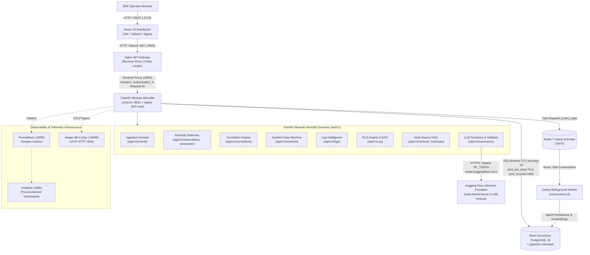
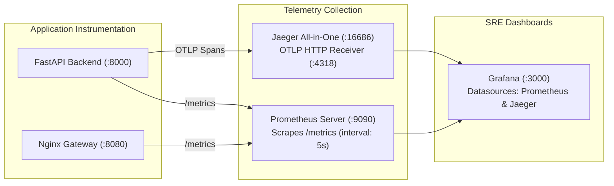

# Vermithor System Architecture

Vermithor is an AI-assisted Production Incident Intelligence Platform designed for Site Reliability Engineering (SRE) and DevOps teams. The platform automates the incident operations lifecycle: streaming telemetry ingestion, metric anomaly detection, dense vector log embedding with unsupervised clustering, service topology and trace-aware Root Cause Analysis (RCA), vector-indexed runbook retrieval (RAG), structured LLM synthesis via Hugging Face Inference Providers, and multi-point programmatic evidence validation.

---

## 1. High-Level Architecture & Topology

Vermithor is architected as a **FastAPI Modular Monolith** fronted by a standard **Nginx (`nginx:alpine`) API Gateway**, backed by **Neon Serverless PostgreSQL 16 (`pgvector`)**, **Redis 7**, and **Celery asynchronous task workers**, with client visualization provided by a **React 18 Single Page Application (SPA)**.



---

## 2. Component Responsibilities

| Component | Technology | Primary Responsibilities |
|---|---|---|
| **API Gateway** | Nginx (`nginx:alpine`) | Reverse proxy and perimeter traffic management: tiered rate limiting per endpoint zone, security headers, request ID injection, timeout management, and reverse proxy routing without Lua dependencies. (JWT authentication is enforced natively in FastAPI). |
| **Frontend Dashboard** | React 18, TypeScript, Vite, Tailwind CSS | SRE operator interface: Real-time incident list, causal dependency graph DAG visualization, log stream viewer, runbook browser, evidence citation inspector, and AI summary viewer. |
| **Modular Monolith Backend** | FastAPI, SQLAlchemy 2.0, Pydantic v2 | Core application hosting 8 domain modules under `/api/v1/`, OpenAPI documentation generation (`/docs`, `/redoc`), database session management, and telemetry instrumentation. |
| **Celery Background Worker** | Celery 5, Python 3.10/3.12 | Asynchronous task processing: Telemetry event batching, dense vector embedding computation, and HDBSCAN log clustering offloaded from the main HTTP thread. |
| **Cache & Task Broker** | Redis 7 (Alpine) | In-memory Celery task message broker and transient result backend with append-only persistence (`--appendonly yes`). |
| **Primary Database** | Neon Serverless PostgreSQL 16 | Relational storage for incidents, events, anomalies, correlation groups, RCA reports, and dense 384-dimensional vector similarity indexing via `pgvector`. |
| **Schema Migrations** | Alembic | Version-controlled DDL schema evolution. Executed as a one-shot container (`vermithor-migration`) before backend and worker services start. |
| **Observability Infrastructure** | Prometheus, Grafana, Jaeger | Metrics scraping, SRE golden signals visualization, and distributed W3C TraceContext tracing. |

---

## 3. End-to-End Request and Telemetry Data Flow

The operational data pipeline transitions through nine distinct stages from raw telemetry ingestion to validated AI incident postmortems:

```text
[ 1. Raw Telemetry Ingestion ]
      POST /api/v1/events (Logs, Metrics, Traces, Deployment markers)
      │ Schema validation via Pydantic -> Enqueued into Celery over Redis
      ▼
[ 2. Metric Anomaly Detection ]
      Dual Engine: Rolling Statistical Z-Score + Scikit-Learn Isolation Forest
      │ Flags observations exceeding standard deviation (3.0σ Warning, 4.0σ Critical)
      ▼
[ 3. Log Sanitization & Dense Embeddings ]
      Log Intelligence Module: Regex redaction (JWTs, keys, IPs) + Drain template extraction
      │ Cloud Inference (HF Providers sentence-transformers/all-MiniLM-L6-v2) -> 384-D vector -> pgvector storage
      ▼
[ 4. Temporal & Topological Signal Correlation ]
      Correlation Engine: Sliding time windows (e.g., 300s) + Service topology proximity
      │ Groups co-occurring anomalies into Correlation Groups
      ▼
[ 5. Authoritative Incident Creation ]
      Incident Service: Materializes incident in DETECTED state (e.g. INC-000001)
      │ Links all associated telemetry events and establishes timeline milestones
      ▼
[ 6. Root Cause Analysis (RCA) & Causal DAG ]
      RCA Engine: Builds NetworkX directed acyclic graph based on temporal precedence
      │ Scores candidate failure hypotheses across weighted architectural dimensions
      ▼
[ 7. Multi-Source RAG Context Assembly ]
      Retrieval Module: Cosine similarity search over historical incidents & runbooks
      │ Assembles citation-budgeted prompt context (### [RUNBOOK:key], ### [LOG:id])
      ▼
[ 8. Evidence-Grounded LLM Summary Synthesis ]
      Summary Module: Connects to Hugging Face Inference Providers (meta-llama/Llama-3.1-8B)
      │ Injects prompt defenses, enforces JSON schema, and executes EvidenceValidator
      │ Discards ungrounded hallucinated claims; falls back to deterministic rule engine if API fails
      ▼
[ 9. SRE Dashboard Visualization ]
      Operator reviews interactive causal DAG, verified evidence citations, and recommended runbooks
```

---

## 4. AI/ML Subsystems

### 4.1 Metric Anomaly Detection (`backend/app/anomaly/`)
Vermithor employs a dual-detector architecture to detect anomalies without requiring labeled training datasets:
- **Statistical Detector (`StatisticalDetector`)**: Computes rolling mean $\mu$ and standard deviation $\sigma$ across sliding time windows per `(service, metric_name, environment)`. Flags observations where $|z| \ge 3.0$ as `WARNING` and $|z| \ge 4.0$ as `CRITICAL`.
- **Isolation Forest Detector (`IsolationForestDetector`)**: Unsupervised tree ensemble from `scikit-learn` that measures tree partition path length across metric value, rate of change ($\Delta v / \Delta t$), and historical variance. Outputs continuous anomaly scores mapped to confidence intervals.

### 4.2 Log Intelligence & Vector Embeddings (`backend/app/log_intelligence/`)
1. **Secret Masking & Normalization**: Strips JWTs, API keys, passwords, IPv4/IPv6 addresses, UUIDs, and timestamps via deterministic regex patterns before persistence.
2. **Template Extraction**: Applies Drain heuristics to cluster unstructured strings into invariant log message schemas (e.g., `"Connection pool timeout on host <HOST>"`).
3. **Dense Vector Embeddings**: Uses the Hugging Face Inference Providers API (`sentence-transformers/all-MiniLM-L6-v2`) generating 384-dimensional dense vectors with unit L2 normalization, bounded retries (up to 2 retries with exponential backoff on 429/503), batch chunking (size 32), and zero local PyTorch runtime memory overhead.
4. **HDBSCAN Clustering**: Clusters log vectors across density landscapes (`min_cluster_size=2`, metric=`euclidean`), reducing repetitive log alerts.

### 4.3 Incident Correlation & Service Topology (`backend/app/correlation/`, `backend/app/topology/`)
- Correlation groups are evaluated within sliding time windows (`CORRELATION_WINDOW_SECONDS = 900`).
- Weighted scoring combines temporal proximity ($0.20$), service boundary ($0.20$), environment match ($0.10$), distributed trace linkage ($0.25$), severity ($0.05$), metric overlap ($0.10$), and deployment correlation ($0.10$).
- When the correlation score exceeds `AUTO_INCIDENT_THRESHOLD` ($0.85$), an incident record is materialized automatically.

### 4.4 Root Cause Analysis (RCA) Engine (`backend/app/rca/`)
- **Causal Graph Construction**: Models service dependencies and failure signals as a directed acyclic graph (DAG) using NetworkX. Edge directionality is determined by:
  - Temporal precedence (earlier anomalous observations precede downstream symptoms).
  - Service topology hierarchy (Ingress $\to$ API Gateway $\to$ Core Services $\to$ Database).
  - Error category directionality (Database Connection Timeout $\to$ HTTP 500 Cascade).
- **Candidate Scorer**: Ranks root cause candidates across weighted factors: temporal precedence ($0.25$), anomaly severity ($0.20$), correlation density ($0.15$), downstream impact ($0.15$), deployment proximity ($0.10$), service role ($0.10$), and raw event severity ($0.05$).
- **Ambiguity Preservation**: When evidence confidence is insufficient ($\le 0.40$), the engine preserves `UNKNOWN` rather than guessing a false root cause.

### 4.5 Multi-Source Retrieval / RAG (`backend/app/retrieval/`)
- **Semantic Hybrid Search**: Queries pgvector using cosine distance (`1 - (embedding <=> :query_embedding)`) across operational runbooks and historical postmortems.
- **Context Assembler & Character Budgeting**: Assembles prompt context with strict citation identifiers:
  - `### [INCIDENT:key]`
  - `### [RUNBOOK:key]`
  - `### [LOG:id]`
- Enforces hard character budgets (`MAX_PROMPT_CHARS = 30000`) to prevent LLM context exhaustion.

### 4.6 LLM Provider & Evidence-Grounded Summary (`backend/app/summary/`)
- **Hugging Face Inference Providers Integration (`HuggingFaceProvider`)**:
  - Connects to the OpenAI-compatible endpoint: `https://router.huggingface.co/v1/chat/completions`.
  - Configured with Bearer token authentication (`HF_TOKEN`), default model `meta-llama/Llama-3.1-8B-Instruct`, and low temperature ($0.1$) for factual determinism.
  - Bounded retries (3 attempts) with exponential backoff on HTTP 429 / 503 rate limits.
- **Evidence Validator (`EvidenceValidator`)**:
  - Validates that every claim and citation ID in the generated summary corresponds to a verified source loaded during retrieval (`valid_source_ids`).
  - Ungrounded claims are automatically stripped, and warnings are appended to the summary `limitations` block.
- **Deterministic Fallback**:
  - If Hugging Face is unconfigured, rate-limited, timed out, or unauthenticated, the service automatically synthesizes a deterministic fallback summary directly from verified RCA candidate data (`is_fallback: true`) without failing the HTTP request.

---

## 5. Neon PostgreSQL & pgvector Integration

### Connection Architecture
Vermithor connects to Neon Serverless PostgreSQL using SQLAlchemy 2.0 and the modern `psycopg` v3 driver (`psycopg[binary]>=3.1.18,<4.0.0`):
- **Scheme Normalization**: Application settings and Alembic automatically normalize connection strings (`postgres://`, `postgresql://`, `postgresql+psycopg2://`) to `postgresql+psycopg://`, ensuring the installed v3 driver is loaded without breaking on SQLAlchemy default `psycopg2` lookups.
- **Connection Pooling & Auto-Suspend Resilience**:
  - `pool_pre_ping=True`: Issues a lightweight `SELECT 1` ping before handing out connections. If Neon suspended its serverless compute during idle periods, SQLAlchemy detects stale sockets and reconnects transparently.
  - `pool_recycle=1800`: Recycles idle connections every 30 minutes, preventing stale SSL connections.
- **Separate Pooled vs. Unpooled Endpoints**:
  - `DATABASE_URL`: Injected into `backend` and `worker` targeting Neon's pooled endpoint (PgBouncer).
  - `DATABASE_URL_UNPOOLED`: Injected into `migration` targeting Neon's direct endpoint with `poolclass=pool.NullPool` to execute DDL operations without pooler locking restrictions.
- **pgvector Extension**:
  - Alembic migration `001_initial_schema.py` executes `CREATE EXTENSION IF NOT EXISTS vector;`.
  - Dense float vectors (dimension $384$) are stored in `log_entries` and `runbooks` with HNSW cosine distance indexing.

---

## 6. Observability & SRE Telemetry

Vermithor separates infrastructure telemetry from application instrumentation:



### 6.1 Metrics (`Prometheus` & `Grafana`)
- **Backend Instrumentation**: Uses `prometheus_client` exposing `/metrics` with standard HTTP golden signals:
  - `http_requests_total`: Counter partitioned by method, endpoint, and status.
  - `http_request_duration_seconds`: Histogram with latency buckets from $5\text{ms}$ to $10\text{s}$.
  - `active_requests`: Gauge tracking in-flight concurrent requests.
  - `vermithor_summaries_generated_total`: Domain counter tracking summary generation success and fallback counts.
- **Grafana Provisioning**: Automatically provisions Prometheus and Jaeger datasources from `infrastructure/grafana/provisioning/` and mounts dashboard `vermithor-overview.json`.

### 6.2 Distributed Tracing (`Jaeger` & `OpenTelemetry`)
- HTTP requests propagate distributed trace context using the W3C TraceContext standard (`traceparent`).
- The API Gateway injects `$req_id` into `X-Request-ID` and passes upstream headers to FastAPI.
- FastAPI exports trace spans to Jaeger via OTLP HTTP (`http://jaeger:4318/v1/traces`).

---

## 7. Evaluation Benchmark Integration

Vermithor includes a quantitative evaluation benchmark suite (`evaluation/evaluator.py`) verifying incident accuracy across 7 deterministic failure scenarios:

| Benchmark Scenario | Simulated Operational Failure | Target Primary Root Cause |
|---|---|---|
| `database_saturation.yaml` | Connection pool exhaustion in booking API | Database degradation on PostgreSQL |
| `bad_deployment.yaml` | Faulty application release v2.4.8 | Code regression / deployment marker |
| `redis_failure.yaml` | Cache node socket drop tripping circuit breakers | Cache failure on Redis |
| `memory_exhaustion.yaml` | JVM heap leak leading to OOMKilled events | Memory exhaustion on service |
| `traffic_spike.yaml` | Uncontrolled ingress load saturating worker threads | Traffic surge / CPU starvation |
| `auth_failure.yaml` | Expired JWKS signing key rotation | Authentication key expiration |
| `ambiguous_noise.yaml` | Uncoordinated transient network jitter | Preserves `UNKNOWN` root cause |

### SLA Targets vs. Verified Performance
- **RCA Top-1 Accuracy**: Target $\ge 80.0\%$, Verified **100.0%** (7/7).
- **RCA Top-3 Accuracy**: Target $\ge 95.0\%$, Verified **100.0%** (7/7).
- **Mean Reciprocal Rank (MRR)**: Target $\ge 0.850$, Verified **1.000**.
- **Anomaly Detection F1 Score**: Target $\ge 0.950$, Verified **1.000**.
- **LLM Output JSON Validity**: Target $100.0\%$, Verified **100.0%**.
- **Ambiguity Preservation Rate**: Target $100.0\%$, Verified **100.0%**.
