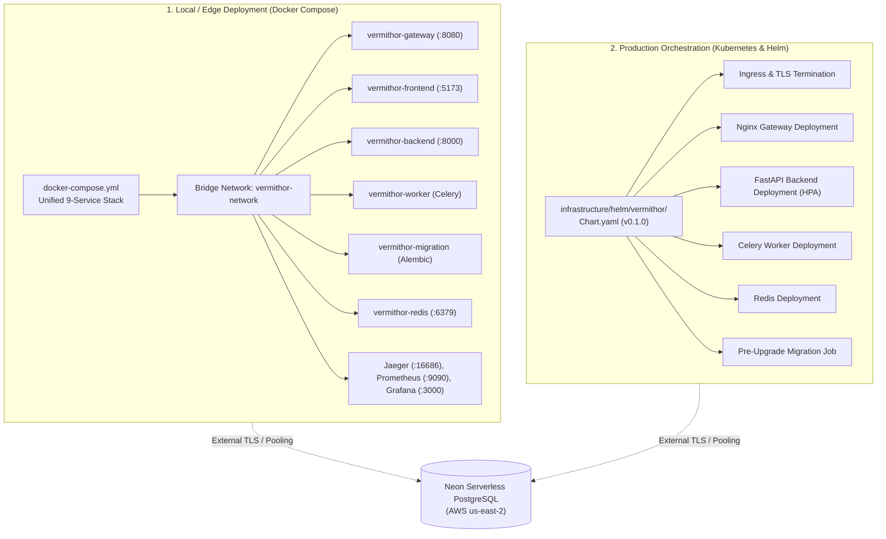

# Vermithor Deployment & Operations Guide

This guide details the deployment architectures, orchestration strategies, secret management, migration ordering, health checking, backup procedures, and production readiness limitations for the **Vermithor** AI Production Incident Intelligence Platform.

---

## 1. Deployment Models Overview

Vermithor supports two distinct deployment tiers:



---

## 2. Docker Compose Deployment (Local & Demo Stack)

### 2.1 Prerequisites
- Docker Engine `24.0+` with Docker Compose `v2.20+` (or Docker Desktop).
- At least 4GB of available host RAM.
- Outbound internet access for Neon PostgreSQL and Hugging Face API router.

### 2.2 Service Roles & Dependencies
In [`docker-compose.yml`](file:///c:/Users/13ver/Desktop/New%20folder/project/Vermithor/docker-compose.yml), services are strictly ordered to guarantee that database migrations complete before applications start:

| Service | Container Name | Port Mapping | Healthcheck / Condition | Dependencies (`depends_on`) |
|---|---|---|---|---|
| `redis` | `vermithor-redis` | `127.0.0.1:6379:6379` | `redis-cli ping` (interval: 5s) | None |
| `jaeger` | `vermithor-jaeger` | `16686:16686`, `4317`, `4318` | None | None |
| `prometheus` | `vermithor-prometheus` | `9090:9090` | None | `gateway`, `backend` |
| `grafana` | `vermithor-grafana` | `3000:3000` | None | `prometheus`, `jaeger` |
| `migration` | `vermithor-migration` | Internal | None (`restart: "no"`) | None (Connects directly to Neon) |
| `backend` | `vermithor-backend` | `8000:8000` | `curl -f http://localhost:8000/health` | `redis: service_healthy`<br/>`migration: service_completed_successfully` |
| `worker` | `vermithor-worker` | Internal | None | `redis: service_healthy`<br/>`migration: service_completed_successfully` |
| `gateway` | `vermithor-gateway` | `8080:80` | `wget -qO- http://127.0.0.1:80/health` | `backend: service_healthy` |
| `frontend` | `vermithor-frontend` | `5173:80` | `wget -qO- http://127.0.0.1:80/` | `gateway` |

### 2.3 Compose Startup & Teardown Commands
```bash
# Build images and start all containers in detached mode
docker compose up -d --build

# Check live container status
docker compose ps

# View unified startup logs
docker compose logs -f

# Inspect database migration container logs
docker compose logs migration

# Stream backend API logs
docker compose logs -f backend

# Stop and remove containers and networks (preserves named volumes)
docker compose down

# Stop and wipe persistent cache/metrics volumes
docker compose down -v
```

### 2.4 Persistent Named Volumes
- `redis_data`: Append-only file persistence for task queue messages.
- `prometheus_data`: Time-series metric database storage (`/prometheus`).
- `grafana_data`: Dashboard state and user configurations (`/var/lib/grafana`).

*(Note: PostgreSQL data persists in the remote Neon cloud project; embeddings are computed via cloud APIs with zero local volume requirements).*

---

## 3. Kubernetes & Helm Deployment (Production Architecture)

Production manifests are maintained in `infrastructure/helm/vermithor/`.

### 3.1 Prerequisites
- Kubernetes cluster `v1.26+` (EKS, GKE, AKS, or bare metal).
- Helm `v3.12+`.
- `kubectl` authenticated with cluster administration permissions.
- Ingress controller (e.g., `ingress-nginx`) with TLS certificate issuer (`cert-manager`).

### 3.2 Helm Chart Values & Structure
```text
infrastructure/helm/vermithor/
├── Chart.yaml              # Chart definition (v0.1.0)
├── values.yaml             # Default production values
├── values-dev.yaml         # Resource-constrained dev cluster overrides
├── values-prod.yaml        # High Availability (HA) overrides with HPA
└── templates/              # Kubernetes resource manifests
    ├── deployment-backend.yaml
    ├── deployment-frontend.yaml
    ├── deployment-gateway.yaml
    ├── deployment-worker.yaml
    ├── job-migration.yaml
    ├── service-*.yaml
    ├── ingress.yaml
    ├── hpa.yaml
    └── secrets.yaml
```

### 3.3 Production Deployment Workflow
1. **Validate Helm Chart Syntax**:
   ```bash
   helm lint infrastructure/helm/vermithor
   ```

2. **Dry-Run Installation**:
   ```bash
   helm install vermithor infrastructure/helm/vermithor \
     --namespace vermithor --create-namespace \
     --values infrastructure/helm/vermithor/values-prod.yaml \
     --dry-run --debug
   ```

3. **Deploy to Cluster**:
   ```bash
   helm upgrade --install vermithor infrastructure/helm/vermithor \
     --namespace vermithor --create-namespace \
     --values infrastructure/helm/vermithor/values-prod.yaml
   ```

4. **Verify Pod Rollout**:
   ```bash
   kubectl get pods -n vermithor -o wide
   kubectl rollout status deployment/vermithor-backend -n vermithor
   ```

---

## 4. Secret Management & Neon Database Configuration

### 4.1 Secret Isolation Principles
- **No Tracked Credentials**: Secrets, passwords, and private tokens must never be committed to Git.
- **Docker Build Context Isolation**: Dockerfiles never accept secrets as build arguments or copy `.env` files into images. Multi-stage builds compile packages in builder stages and discard compiler tools in runtime images.
- **Kubernetes Secret Management**: In production, secrets are managed through an external secret operator (HashiCorp Vault, AWS Secrets Manager, or SealedSecrets) referencing `secrets.existingSecret`.

### 4.2 Neon PostgreSQL SSL & Migration Order
- **Enforced Encryption**: Neon requires TLS encryption. Connection strings must specify `?sslmode=require` (and optionally `&channel_binding=require`).
- **Connection Pooling**:
  - `DATABASE_URL`: Set to Neon's PgBouncer pooled endpoint (`ep-...-pooler...`).
  - `DATABASE_URL_UNPOOLED`: Set to Neon's direct endpoint (`ep-...`) for DDL migrations.
- **Migration Safety**: Migrations run via Kubernetes pre-upgrade Helm hooks or the one-shot `vermithor-migration` container before application pods begin serving traffic.

---

## 5. Health Probes, Rollback & Disaster Recovery

### 5.1 Container & Kubernetes Probes
- **Liveness Probe**: `GET /health` on port 8000 (HTTP 200). Restarts deadlocked containers.
- **Readiness Probe**: `GET /ready` on port 8000. Validates database reachability (`SELECT 1`) and embedding model status. If degraded, the pod is removed from ingress routing without triggering a container restart.

### 5.2 Rollback Procedures
- **Application Rollback (Helm)**:
  ```bash
  # Check revision history
  helm history vermithor -n vermithor

  # Rollback to previous working revision
  helm rollback vermithor <REVISION_NUMBER> -n vermithor
  ```
- **Database Schema Rollback (Alembic)**:
  ```bash
  alembic downgrade -1
  ```
  *(Caution: Downgrades must be validated to prevent accidental data truncation).*

### 5.3 Backup & Data Retention Targets
- **Logical Database Backup (`pg_dump`)**:
  ```bash
  pg_dump "$DATABASE_URL_UNPOOLED" -F c -b -v -f vermithor_backup_$(date +%Y%m%d_%H%M%S).dump
  ```
- **Logical Restore (`pg_restore`)**:
  ```bash
  pg_restore -d "$DATABASE_URL_UNPOOLED" --clean --if-exists vermithor_backup_latest.dump
  ```
- **Operational Planning Targets**:
  - **Recovery Point Objective (RPO)**: 24 hours (via daily automated logical dumps or Neon Cloud Point-in-Time Recovery).
  - **Recovery Time Objective (RTO)**: 30 minutes (time to provision a clean namespace and restore schema/data).

---

## 6. Production Readiness Limitations & Unverified Items

The following operational capabilities represent verified implementations vs. planned/unverified enterprise requirements:

| Operational Domain | Status | Notes & Production Requirements |
|---|---|---|
| **Application Layer** | `READY` | Modular monolith with FastAPI, async processing, and 41+ passing regression tests. |
| **Authentication & Auth Boundary** | `READY WITH CONDITIONS` | HS256 JWT validation active at Gateway. Production requires enterprise IdP (OIDC/Keycloak/Auth0). |
| **Secrets Management** | `READY WITH CONDITIONS` | Environment variables in Docker Compose; Helm `existingSecret` ready. Direct Vault/KMS daemon syncing unverified. |
| **TLS & Perimeter Encryption** | `READY WITH CONDITIONS` | Ingress configured for TLS termination. Production requires automated CA certificates via `cert-manager`. |
| **Database Architecture** | `READY` | Serverless Neon PostgreSQL with `pgvector`, connection pooling, and Alembic versioning verified. |
| **Redis Broker / Caching** | `READY WITH CONDITIONS` | Standalone Redis instance with AOF persistence. Lacks multi-node Sentinel or Redis Cluster HA. |
| **Observability & Golden Signals** | `READY` | Prometheus scraping and pre-provisioned Grafana dashboards verified. |
| **CI/CD Automation** | `READY` | GitHub Actions workflows enforce linting, unit tests, and build validation. |
| **Backup Automation** | `NOT READY / UNVERIFIED` | Manual `pg_dump` and Neon console PITR available; automated offsite cloud backup scripts not implemented. |
| **Disaster Recovery (Cross-Region)** | `NOT READY / UNVERIFIED` | Single-region cloud architecture; automated multi-region active-passive failover unverified. |
| **Cloud WAF** | `NOT READY / PLANNED` | Nginx perimeter rate limiting active; cloud edge WAF (Cloudflare/AWS WAF) not deployed. |
| **SIEM Integration** | `NOT READY / PLANNED` | Local logs and OpenTelemetry spans active; centralized SIEM log shipping (Splunk/Datadog) unconfigured. |
