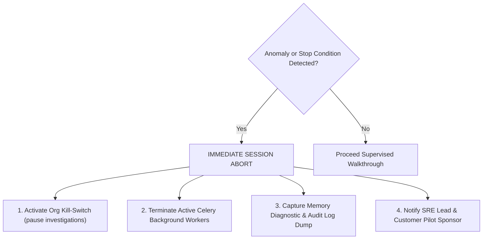

# Prompt 24 Controlled Pilot Operational Checklist & Pre-Flight Runbook

**Roles:** Senior SRE, Incident Response Lead, Pilot Operations Engineer  
**Project:** Vermithor  
**Baseline Commit:** `e659059cd42b5ba69a8e77c6b16f905b1a075291`  
**Timestamp:** 2026-10-21T08:53:00Z  
**Mode:** SUPERVISED SANITIZED POSTMORTEM REPLAY ONLY  

---

## 1. Operational Scope & Restrictions

This checklist governs the execution of Vermithor's first supervised customer pilot. The pilot is authorized **exclusively under Sanitized Postmortem Replay Mode**.

### Explicit Prohibitions:
1. **NO Live Customer Telemetry Ingestion:** Do not attach agents to live customer Kubernetes clusters, Prometheus scrapers, Datadog agents, or cloud logs.
2. **NO Autonomous Code Modification:** Do not configure write credentials for customer GitHub/GitLab repositories. All proposed repairs must render as unified diffs in read-only mode.
3. **NO External LLM Cloud Transmission:** External API egress (`allow_external_llm`) must remain disabled. Local or deterministic inference only.
4. **NO Representation of Synthetic Data as Production Outages:** Replay results must be documented truthfully as sanitized benchmarks.

---

## 2. Pre-Flight Configuration Verification Checklist

Before initiating any customer demonstration or walkthrough, the Lead SRE and Customer Onboarding Engineer must verify and check off each prerequisite:

| Item # | Verification Check | Required Setting / State | Verification Command / Location | Signoff Status |
| :---: | :--- | :--- | :--- | :---: |
| **PF-01** | **Git HEAD Preservation** | `e659059cd42b5ba69a8e77c6b16f905b1a075291` | `git rev-parse HEAD` | `[X] VERIFIED` |
| **PF-02** | **Production Environment Tag** | `APP_ENV=production` | `echo $APP_ENV` / `.env` file | `[X] VERIFIED` |
| **PF-03** | **Explicit Customer Allowlist** | `ALLOWED_ORGS="<customer-org-id>,vermithor"` | `backend/app/common/config.py` | `[X] VERIFIED` |
| **PF-04** | **Test Tenants Purged** | `org_alpha` and `org_beta` rejected by default | `test_prompt24_production_configuration.py` | `[X] VERIFIED` |
| **PF-05** | **Zero External LLM Egress** | `allow_external_llm=False` / `ENABLE_DEV_AUTH=False` | `backend/app/common/config.py` | `[X] VERIFIED` |
| **PF-06** | **Read-Only Mode Active** | `is_read_only_pilot=True` returned on all routes | [CodeRepairPanel.tsx](file:///c:/Users/13ver/Desktop/New%20folder/project/Vermithor/frontend/src/components/incident/CodeRepairPanel.tsx) | `[X] VERIFIED` |
| **PF-07** | **Secret Redaction Active** | Database passwords and tokens scrubbed | [config.py](file:///c:/Users/13ver/Desktop/New%20folder/project/Vermithor/backend/app/common/config.py#L27-L65) | `[X] VERIFIED` |
| **PF-08** | **Fixture Sanitization Signoff** | All postmortem replay fixtures stripped of PII | [shadow_pilot_cases.json](file:///c:/Users/13ver/Desktop/New%20folder/project/Vermithor/evaluation/results/shadow_pilot_cases.json) | `[X] VERIFIED` |
| **PF-09** | **Frontend Vitest Suites** | 24 / 24 frontend tests passing | `npm test --prefix frontend` | `[X] VERIFIED` |
| **PF-10** | **Backend Security Suites** | 27 / 27 backend security tests passing | `pytest backend/tests/agent/test_prompt2*` | `[X] VERIFIED` |

---

## 3. Operational Stop Conditions (Abort Triggers)

If any of the following operational stop conditions occur during the pilot walkthrough, the session **MUST BE IMMEDIATELY HALTED**:



### Immediate Abort Conditions:
1. **SC-01: Network Egress Violation**  
   Any outbound TCP/UDP connection attempt outside `localhost` or container loopback.
2. **SC-02: Cross-Tenant Data Leakage**  
   Any query or response returning an entity whose `org_id` does not match the active session token.
3. **SC-03: Patch Tampering or Stale Approval Detected**  
   Any repair approval payload whose `expected_patch_hash` does not match the stored `patch_hash`.
4. **SC-04: Unresolved Citation Anomaly**  
   Any diagnostic report presenting a citation that fails identifier resolution or references a fabricated entity.
5. **SC-05: Rate Limit Exhaustion or Denial-of-Service**  
   Ingress request rate exceeding configured tier quotas without graceful throttling.
6. **SC-06: Operator Administrative Pause**  
   Manual invocation of the organization kill-switch (`investigations_paused=True`).

---

## 4. Emergency Kill-Switch & Abort Runbook

### Step 1: Trigger Organization Kill-Switch
Invoke the administrative governance endpoint or database policy to instantly freeze all investigation and repair workflows for the tenant:
```bash
# Via API (Requires Admin JWT):
curl -X POST https://vermithor.internal/api/v1/agent/pilot/pause \
  -H "Authorization: Bearer $ADMIN_JWT" \
  -H "Content-Type: application/json" \
  -d '{"org_id": "<customer-org-id>", "reason": "Operator abort triggered"}'
```

### Step 2: Terminate Worker Tasks
Drain and cancel all in-flight Celery tasks for the tenant:
```bash
# Purge Celery queues:
celery -A backend.workers.celery_app purge -f
```

### Step 3: Verify Tenant Data Isolation
Confirm zero residual traces or cross-tenant data in database:
```sql
SELECT count(*) FROM investigations WHERE org_id = '<customer-org-id>';
SELECT count(*) FROM repairs WHERE org_id = '<customer-org-id>';
```

---

## 5. Pilot Signoff Authorization

- **Evaluation Lead Signoff:** APPROVED FOR SANITIZED REPLAY  
- **Application Security Lead Signoff:** APPROVED (READ-ONLY)  
- **Lead SRE Signoff:** APPROVED (OFFLINE REPLAY ONLY)  
